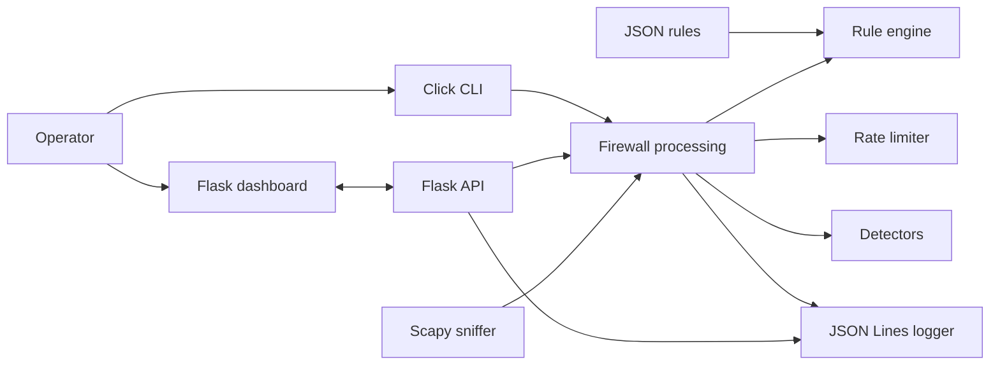

# How PyGuard Works

## Overview

PyGuard is a local monitoring and rule-evaluation application. The operator starts packet capture from the CLI or dashboard. Captured packets are parsed, evaluated in process, and represented as JSON log events. PyGuard does not install an operating-system packet filter and does not drop packets.

## High-level architecture

## Main components

- `pyguard/main.py` defines the Click commands and starts CLI actions.
- `pyguard/core/packet_sniffer.py` uses Scapy to sniff and parse IPv4 TCP, UDP and ICMP packets.
- `pyguard/core/firewall.py` coordinates rule evaluation, rate checks and detection.
- `pyguard/core/rule_engine.py` loads and matches configured rules.
- `pyguard/core/rate_limiter.py` maintains global and per-source packet counters.
- `pyguard/core/logger.py` writes structured JSON Lines events to `pyguard/logs/pyguard.log`.
- `pyguard/web/` provides Flask pages and API routes.
- `pyguard/attack_simulator/` generates constrained local test traffic.

## Packet capture workflow

1. The operator starts capture through the dashboard or CLI.
2. Scapy listens on the selected interface (or its configured default) with the default BPF filter `ip`.
3. The sniffer extracts IPv4 source/destination addresses, protocol, ports when present, and TCP flags into packet data for processing.
4. The firewall evaluates the packet and records applicable decisions and detections.

Capture is not started by launching the web server. Windows requires a Scapy-compatible provider such as Npcap; Linux may need libpcap and elevated capabilities. Errors are logged and surfaced by the UI/CLI. Dashboard pages can still be used when capture is unavailable.

## Packet parsing and filtering

The current parser handles IPv4 packets containing TCP, UDP or ICMP. It does not implement IPv6 parsing. Interface selection and the Scapy capture filter affect which packets are observed. Capturing packets does not put PyGuard inline with traffic and does not itself enforce a decision.

## Firewall rule evaluation

The rule engine checks enabled rules from top to bottom and returns the first match. Address matching is exact string equality; ports are exact values and protocol matching uses the supported protocol names. CIDR/network-range matching is not implemented. If no rule matches, `default_policy` is used.

The current configuration includes a final catch-all `rate_limit_global` rule. Because it matches any packet and first-match wins, it shadows the fallback policy and makes rules appended after it unreachable. See [rules.md](rules.md) before editing or adding rules.

An allow decision still passes through the rate limiter. A block decision is logged and processing returns; this does not cause an operating-system drop. Rule reload checks happen while packets are processed, approximately every two seconds, rather than through a background filesystem watcher.

## Suspicious-activity detection and rate limiting

The application tracks distinct destination ports by source/destination pair over a five-second window for port-scan heuristics. It also counts TCP connection attempts for selected service ports over a ten-second window for brute-force heuristics. The configured thresholds are heuristic triggers, not validated detection guarantees.

Global and per-source rate limits are applied in process. A rate-limit denial is treated as a flood-related event. The `flood_threshold_pps` configuration value is present but is not used by the current detection path. Detection logs alerts; it does not block at the operating-system level.

## Rule modification

Rules can be edited in `pyguard/config/rules.json` and managed through CLI/API/dashboard features. Rule modifications use the same first-match ordering, so placing a new rule after a catch-all may make it ineffective. Rule field details and examples are in [rules.md](rules.md).

## Alert generation and logging

The logger writes one JSON object per line with fields such as timestamp and event type. Events include rule decisions, suspicious detections, rate-limit activity and simulator activity. Port-scan and brute-force detections can produce both suspicious and alert records. The log is local and has no configured rotation.

## Flask dashboard interaction

The Flask app serves the homepage, about page and dashboard, plus `/api` endpoints for dashboard operations. Rule testing endpoints evaluate synthetic packet data; they do not transmit packets. The dashboard simulation feature invokes the local simulator. The built-in Flask server binds to `0.0.0.0` by default and has no authentication, so it is intended for trusted local use only.

## Limitations and external dependencies

- Scapy and a host capture provider are required for packet capture; installation and privileges vary by operating system.
- Capture must be started manually and currently covers IPv4 only.
- Decisions are logged but are not enforced by OS firewall mechanisms.
- Rules support exact matching, not CIDR ranges.
- Simulator traffic and synthetic rule tests are distinct; neither guarantees a particular captured alert.
- IP geolocation needs an external service and optional API key. Basic local dashboard use does not require it.
- The Flask development server is not an authenticated production deployment.
