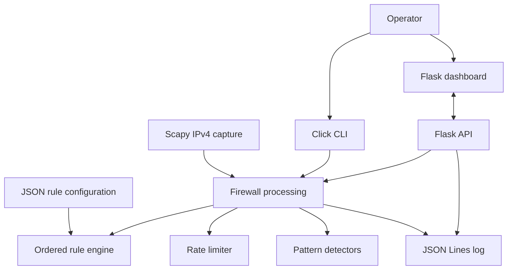

# PyGuard Project Report

## 1. Abstract

PyGuard is an educational Python application for observing supported IPv4 traffic, evaluating configurable packet rules, applying in-process rate checks, recording selected suspicious-activity events, and presenting information through a Flask dashboard. Its simulator supports constrained local demonstrations. PyGuard records decisions but does not enforce packet drops through the operating system.

## 2. Introduction

Network monitoring helps operators inspect traffic and identify patterns that merit attention. Configurable packet filters make decisions easier to review, while rate limits and simple pattern checks can surface unusually frequent or varied activity. PyGuard demonstrates these ideas in a local Python application with a dashboard and structured event log.

## 3. Objectives

1. Capture and parse supported IPv4 TCP, UDP and ICMP traffic when capture prerequisites are available.
2. Evaluate packets against configurable, ordered rules.
3. Apply global and per-source rate checks and selected suspicious-activity heuristics.
4. Record rule decisions, detections and simulator activity in structured logs.
5. Provide dashboard, CLI and loopback-constrained simulation features for controlled review.

## 4. Feasibility Study

### Technical feasibility

The implementation uses Python, Scapy, Click, Flask and Requests, with JSON configuration and local JSON Lines logs. Packet capture depends on an OS-compatible provider such as Npcap on Windows or libpcap on Linux, plus interface access and permissions. The repository does not declare a supported Python version or include a tested environment matrix.

### Operational feasibility

The application runs locally and exposes a browser dashboard. Operators must start packet capture separately from the web server. The bundled Flask server has no authentication and binds to all interfaces by default, so it is suitable only for trusted local use in its current configuration. Decisions are not OS-enforced.

### Economic feasibility

The listed Python libraries and local runtime are open source. No formal cost study was performed. Host setup, maintenance and any optional external geolocation service may carry separate operational costs.

## 5. Literature Survey

This is a concise conceptual survey; no external literature references or benchmarks are included. Traditional packet-filtering firewalls apply ordered rules to network fields. Network intrusion detection systems use signatures or behavior patterns to identify activity for review. Open-source packet-inspection tools and Python networking libraries provide ways to capture and process traffic. PyGuard is a small educational example of these concepts rather than a replacement for mature firewall or IDS platforms.

## 6. Proposed Methodology

1. Load JSON configuration and initialize the selected CLI or Flask entry point.
2. When an operator starts capture, use Scapy to observe IPv4 traffic on the selected/default interface.
3. Parse addresses, protocol, available ports and TCP flags.
4. Evaluate enabled rules in order, using exact address and port matches.
5. Apply in-process global/per-source rate checks and supported port-scan/brute-force heuristics.
6. Write decision, alert and simulation events to the JSON Lines log.
7. Present supported status and event data through the Flask dashboard and API.

## 7. System Design

The Click CLI and Flask dashboard expose operator actions. The Scapy sniffer supplies packet data to firewall processing. Rule evaluation, rate limiting and heuristic detection produce events for the logger; dashboard routes read or invoke supported services.

Technology stack: Python, Scapy, Click, Flask, Requests, JSON configuration and JSON Lines logs. Rules use first-match order; the shipped catch-all rate-limit rule can shadow rules placed after it. Simulator and rule-test workflows are distinct from live packet capture.

## 8. Results

### Implemented functionality

Source inspection confirms CLI commands, Flask pages/API, configurable ordered rule evaluation, Scapy-based IPv4 packet parsing, rate-limit/detection paths, structured logging, dashboard testing endpoints and loopback-constrained simulation modules.

### Tests actually executed

During this documentation update, source/configuration files were inspected and Markdown links were checked. No Python runtime was available in the environment, so no application command, installation, browser route, packet capture or Python tests were run. No Python test suite was found in the repository.

### Known limitations

PyGuard logs decisions but does not enforce OS-level drops. Packet capture is manual, host-dependent and IPv4-only. Exact IP matching is used; CIDR is unsupported. The catch-all rule affects later rule ordering. The built-in web server has no authentication and binds to all interfaces. The configured flood threshold key is not used by the current detection path.

### Not verified

Clean-machine installation, specific Python-version compatibility, capture behavior on a particular host, detection accuracy, performance, and successful generation of particular alerts were not verified. No accuracy or throughput metrics are claimed.

## 9. Conclusion

PyGuard provides an educational interface for local packet observation, configurable rule decisions, basic heuristic events, simulation and dashboard review. It is useful for demonstrating these workflows, with prerequisites and limitations made explicit. Future work could include version-tested installation support, stronger rule editing validation, log rotation, IPv6 support, authenticated deployment and integration with an actual OS enforcement mechanism.
